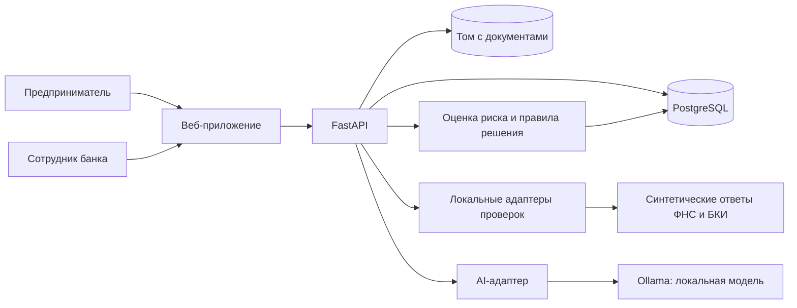
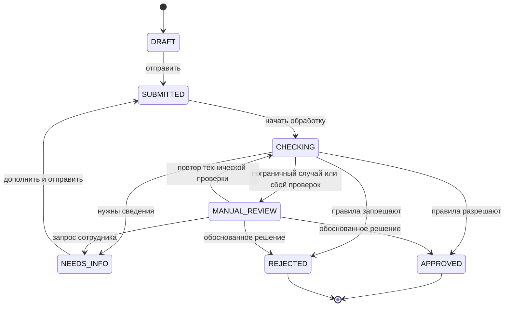

# Архитектура: умный кредитный кабинет

> Обновление demo-0.3: для нового продукта WC_DEMO/version=3 действуют [PRICING.md](PRICING.md) и [PRICING_CHECK.md](PRICING_CHECK.md): 20% минимум, 6–60 месяцев, пять целей и персональные скидки. Числа и примеры demo-0.2 ниже относятся к историческому продукту v2; новые заявки проверять по PRICING_CHECK.md. Текущая миграция — 0005_personal_pricing.

Статус: **согласованная архитектура для demo-0.2, реализация разрешена**. Распределение ролей, Python/FastAPI, предметный контракт и AI-помощь внутри подбора приняты командой. Конкретные поля, форматы, 15 шагов решения и сценарии задает [SYNTETIC.md](SYNTETIC.md). Frontend React/TypeScript/Vite подтвержден командой. Структура src/credit_cabinet создана; FastAPI/модели/миграции/сессии реализованы. Импорт C01/C02, черновики, отправка/снимки, локальные проверки, скоринг/авторешение, дозапрос/новая отправка, технический retry и сравнение вариантов уже реализованы; банковская очередь/карточка, история, ручной дозапрос/решение и демо-документы также реализованы. AI-навигатор реализован по AI_CHECK.md; frontend и Docker остаются у Ксюши и Димы. Текущий запуск: BACKEND.md, проверка документов: DOCUMENTS_CHECK.md.

Источник требований — предоставленный командой PDF «Умный кредитный кабинет предпринимателя», 16 страниц. Ниже отдельно выделены условия кейса, наши предложения и вопросы. Текст задания рассматривается как требования к будущему прототипу; разрешение начать реализацию получено отдельно от пользователя.

## 1. Что необходимо по кейсу

| Требование | Следствие для проекта | Страницы PDF |
| --- | --- | --- |
| Связать клиентский путь и банковскую обработку | Данные и статусы заявки проходят через общий процесс | 6, 9 |
| Сохранение данных и динамическое состояние | Нужны постоянное хранилище и управляемые переходы | 6 |
| Веб-интерфейс, без мобильного приложения | Кабинет клиента работает в браузере | 11 |
| Docker и воспроизводимый запуск на обычном ПК | Обязательная версия поднимается локально | 7 |
| Автономность и синтетические данные | БКИ, ФНС и банковские источники имитируются локально | 10 |
| Отсутствие зависимости от платных ресурсов | Основной сценарий не требует платных API и закрытых лицензий | 10 |
| Весь основной процесс внутри продукта | Дозапросы и уведомления в кабинете, без SMS и мессенджеров | 11 |
| LLM необязательна; при использовании только открытые веса | AI-функции выбираем после готовности основного пути | 11–12 |
| Можно упростить кредитные правила, подпись и выдачу | Упрощения явно описываем и маркируем в интерфейсе | 11 |
| Нужны документация, история Git, тестовые данные и сценарии | Комплект сдачи планируем вместе с разработкой | 7 |

На странице 7 также есть фраза про изменение новостной ленты под клиента. Она не раскрыта в остальной постановке. Нужно уточнить у организаторов, является ли это обязательным требованием или редакционной вставкой. Пока не считаем его закрытым: возможный минимальный вариант — персональные информационные карточки по отрасли и цели кредита на локальном демонстрационном контенте; соответствие такой трактовки требует уточнения.

## 2. Продуктовая идея и границы MVP

Предпринимателю нужен ответ на три вопроса: какое финансирование подходит под его задачу, что необходимо предоставить, что происходит с заявкой и что делать дальше. Сотруднику банка нужны очередь обращений, результаты проверок, объяснение риска и возможность обработать исключение.

Это рабочие гипотезы по кейсу, а не результаты проведенных интервью. Предлагаем проверить их короткими интервью с предпринимателями и человеком с опытом кредитного процесса. Фиксируем реальные ответы и изменения в продукте; не выдаем предположения за CustDev.

Согласованный MVP:

1. Вход под заранее подготовленной учетной записью клиента с хешированием пароля и ограниченной по времени сохраняемой сессией.
2. Выбор потребности, суммы и срока для одного продукта — оборотного кредита. Условия вымышленные. Показываем назначение и ограничения продукта; неподходящую потребность объясняем, не создаем фиктивное предложение.
3. Предзаполненная карточка синтетической компании, финансовые показатели и автосохранение черновика. После закрытия вкладки восстанавливаем последнюю сохраненную заявку и шаг формы. Подготовленный синтетический документ прикрепляется к созданной заявке и затем к отправленному снимку; произвольная загрузка файлов вне текущего объема.
4. Отдельное демо-подтверждение проверки БКИ, отправка, локальная юридическая проверка (включая is_bankrupt), кредитная история, оценка риска и применение demo-policy-0.2. Без подтверждения нет обращения к БКИ и LLM.
5. Одобрение, отказ, запрос уточнения или ручное рассмотрение. Клиент видит статус, понятное объяснение и следующий шаг.
6. Сотрудник банка видит заявку, источники данных, результаты проверок и историю, может запросить уточнение или принять обоснованное решение в рамках доступных правил.
7. После уточнения клиент повторно отправляет заявку, процесс продолжает работу с новой версией данных.
8. AI-навигатор объясняет подтвержденные факторы и сравнение вариантов суммы/срока, рассчитанных backend. Он не принимает кредитное решение и не меняет заявку самостоятельно.

Результат MVP — решение по заявке и демонстрационное подписание одобренных условий. APPROVED → SIGNED сохраняет документ, автора, дату, SHA-256 и событие в PostgreSQL; это эмуляция ЭП без выдачи денег. Повторный просмотр читает сохранённые условия. Второй продукт, реальная выдача и произвольная загрузка документов не включены в текущий хакатон-MVP. Полноценный залоговый процесс, реальный перевод денег и юридически значимую подпись не планируем. Контракт и проверка — [SIGNING_CHECK.md](SIGNING_CHECK.md).

Четыре принятых уточнения demo-0.2: поступления исключают кредиты/взносы/внутренние переводы; operating_outflow не дублирует долг; отдельное подтверждение credit_history_check_allowed защищает также PREVIEW/AI; юридический is_bankrupt различает true/false/null; provenance показывает source/as_of_date/checked_at. Это четыре области изменения, без новых таблиц и без новой AI-функции.

Продуктовое отличие: «навигатор готовности заявки». Перед отправкой клиент видит, какие сведения отсутствуют и какие обнаружены противоречия; после отправки — историю этапов и конкретные действия. Навигатор не обещает одобрение и не советует подгонять сведения под правила.

Главная клиента: компания, «Подобрать финансирование», «Продолжить заявку» при наличии черновика и список обращений. Подбор начинается с создания одного DRAFT; ручной ввод и AI-кнопки работают с одной формой. Предварительные варианты не являются кредитным решением. Состав экранов и банковских действий подробно зафиксирован в [USER_FLOWS.md](USER_FLOWS.md).

## 3. Стек и ответственность

Решение команды: Сергей отвечает за Python/FastAPI, авторизацию, сессии, БД и бизнес-логику; Дима — за Docker и воспроизводимость; Ксюша — за весь frontend; Валера и София — за синтетические данные.

Ксюша реализует frontend на React + TypeScript + Vite. Схема ниже описывает этот вариант; второй frontend в текущем проекте не поддерживаем.

- FastAPI + Pydantic — HTTP API, валидация и OpenAPI ([документация](https://fastapi.tiangolo.com/features/)).
- PostgreSQL + SQLAlchemy + Alembic — постоянные данные, транзакции и миграции.
- React + TypeScript + Vite — согласованный отдельный frontend-проект.
- Argon2id через готовую библиотеку — хеширование паролей; серверные сессии в PostgreSQL.
- Ollama с локальной моделью с открытыми весами — AI-объяснения отдельно от кредитной логики.
- uv и lock-файл Python; npm и lock-файл frontend. Точные совместимые версии фиксируем при реализации.
- Docker Compose — запуск компонентов. pytest — правила, API и доступ; Playwright — критичные пользовательские пути.

Микросервисы, Kubernetes, Kafka, Redis, векторная БД и обучение собственной нейросети в текущих сценариях не обоснованы. Подробные договоренности для совместной работы: [IMPLEMENTATION_PLAN.md](IMPLEMENTATION_PLAN.md).

## 4. Устройство системы

Модульный монолит: бизнес-логика в одном backend-проекте, модули разделены по ответственности. Короткие локальные проверки выполняются в процессе backend. Отдельный worker и постоянную очередь рассматриваем только для дальнейшего развития с долгими интеграциями или OCR.

Модули: учетные записи и сессии; доступ к компаниям; каталог продуктов; заявки и черновики; документы; локальные проверки; скоринг; решение; история; AI-навигатор. Сессия и черновик — разные сущности: истечение входа не удаляет данные заявки.

Это два контура одного приложения: CLIENT работает с компаниями по membership; BANK_STAFF — с отправленными обращениями. Сотрудник не получает неотправленный черновик и правки до новой отправки; клиент не получает внутренние комментарии. Формируем разные ответы API, а не скрываем лишние поля только в браузере.

Для Docker предполагаются `web`, `api`, `db`, одноразовый `init` для миграций/демо-данных и AI-профиль с `ollama` и загрузкой весов. `web` отдает собранный frontend и проксирует `/api`, `/docs` и `/openapi.json` в API, сохраняя единый origin браузера. БД и модель доступны только во внутренней сети. Сборка frontend не является долгоживущим Node.js-сервисом в демонстрационной версии. При выборе шаблонов отдельный frontend build и контейнер web можно упростить.

Исходные демонстрационные документы входят в поставку. При создании заявки API сохраняет их приватные неизменяемые копии в DOCUMENTS_DIR, которому уже сейчас нужен постоянный записываемый volume; метаданные — в PostgreSQL. Скачивание через GET /api/documents/{id} проверяет сессию, права и SHA-256. Банк видит только файлы отправленных версий, клиент — своих компаний. Файлы не публикуются как static. Старые снимки не изменяются. Проверка — DOCUMENTS_CHECK.md. Данные PostgreSQL и будущие веса модели также сохраняются в volumes.

Backend определяет статус и доступные действия, frontend их отображает. Для MVP достаточно опрашивать активную заявку раз в несколько секунд и обновлять ее после действий пользователя; WebSocket пока не требуется.

### Надежность обработки

Для шестидневного MVP отправка сначала сохраняет неизменяемую версию заявки, статус `SUBMITTED` и историю в одной транзакции. Затем тот же запрос запускает короткие локальные проверки. В отдельной короткой транзакции блокируется строка заявки, проверяются версия и состояние, рассчитываются результаты и вместе сохраняются решение и события обработки. Реальных сетевых вызовов внутри этой транзакции нет.

Если процесс остановится между отправкой и итоговым коммитом, сохраненная заявка останется `SUBMITTED`; незавершенная транзакция обработки откатится. В рабочем месте сотрудника предусматриваем явное действие повторной обработки такой заявки с записью в историю. Это осознанное упрощение: автоматического фонового восстановления и масштабирования обработчиков в MVP нет. Сценарий восстановления обязательно проверяем.

Проверки привязываются к версии отправленной заявки. Старый результат не должен менять заявку после ее исправления. Повторное нажатие «Отправить» не создает новую версию при неизменных данных; повтор обработки уже завершенной версии возвращает существующий результат. Имитируемая техническая ошибка БКИ ведет в ручной разбор с соответствующей причиной, а не в кредитный отказ.

Обработка не растягивается искусственными таймерами ради анимации. Быстрые проверки могут завершиться до следующего обновления страницы; реальные изменения по дозапросу и ручному решению отражаются в кабинете клиента. Если позже появятся долгие задачи, переносим обработку в надежную очередь с идемпотентностью и восстановлением после сбоя, а не в непостоянную фоновую задачу внутри API.

## 5. Состояния заявки

Редактирование разрешено в `DRAFT` и `NEEDS_INFO`. При повторной отправке создается новый неизменяемый снимок входных данных. Одобренная и отклоненная заявка в этом MVP завершены; новая попытка — отдельная заявка.

Клиент видит человеческие названия: «Черновик», «Заявка отправлена», «Проверяем данные», «Нужны уточнения», «На рассмотрении специалиста», «Одобрено», «Отказано». Временная ошибка конкретной проверки хранится в ее результате, не превращается в отдельный кредитный статус. Все переходы валидируются на backend.

## 6. Данные и API: первоначальный контракт

| Сущность | Что хранит |
| --- | --- |
| User / CompanyMembership | Пользователь, роль и доступ к конкретной компании |
| AuthSession | Хеш случайного токена, пользователь, срок действия, активность и отзыв сессии |
| Company / CompanyFinancialMonth | Синтетические реквизиты и исходные помесячные денежные показатели |
| Product | Цели, диапазоны суммы/срока, демонстрационные условия и версия |
| Application / ApplicationRevision | Статус, версия для контроля изменений, шаг черновика; неизменяемые снимки отправленных параметров и финансов |
| Document | Метаданные неизменяемого файла; отправленная версия содержит ссылки и контрольные суммы |
| Assessment / CheckResult | Запуск оценки отправленной версии, его проверки, риск, факторы, правила и технические ошибки |
| Decision | Решение, условия, причины, автор и версия продуктовой политики |
| InformationRequest | Дозапрос, требуемые сведения и новая отправка с ответом |
| ApplicationEvent | История действий и переходов, роль автора, время |
| AdvisorResult | Версия входа, рассчитанные варианты, версия модели/промпта, результат и отметка fallback |

Связи: компания имеет участников и заявки; заявка относится к одной версии продукта и имеет несколько отправленных версий. Проверки относятся к запуску оценки, запуск и решение — к конкретной отправке. Пользователь видит только разрешенные компании; роль сотрудника проверяется отдельно. Поля, типы, ключи, ограничения, JSON-снимки, индексы и последовательность миграций: [DATABASE.md](DATABASE.md).

В v1 деньги храним NUMERIC(18,2), RUB; в API — десятичные строки, в Python — Decimal. Фиксируем единицы и периоды финансовых показателей. Время событий храним в UTC и отображаем с выбранным часовым поясом.

Целевой состав API. Вход/сессии, компании/продукт, черновики/события, submit, клиентское чтение revision/decision, retry-processing и scenarios реализованы; банковские очередь/карточка/версии/история, request-info и decision тоже реализованы. Документы и advisor также реализованы; приемка — DOCUMENTS_CHECK.md и AI_CHECK.md. Ручная приемка банка — BANK_CHECK.md. Текущая OpenAPI — docs/openapi.json:

| Действие | Предлагаемый маршрут |
| --- | --- |
| Вход, текущий пользователь, выход | `POST /api/auth/login`, `GET /api/auth/me`, `POST /api/auth/logout` |
| Начальная CSRF-защита | `GET /api/auth/csrf` |
| Каталог | `GET /api/products` |
| Разрешенные компании и исходный профиль | `GET /api/companies`, `GET /api/companies/{id}` |
| Свои заявки и создание черновика | `GET /api/applications`, `POST /api/applications` |
| Просмотр и редактирование | `GET /api/applications/{id}`, `PATCH /api/applications/{id}` |
| Получение демо-документа; загрузка — расширение | `GET /api/documents/{id}`; опционально `POST /api/applications/{id}/documents` |
| Отправка версии | `POST /api/applications/{id}/submit` |
| История и решение | `GET /api/applications/{id}/events`, `GET /api/applications/{id}/decision` |
| Очередь сотрудника | `GET /api/bank/applications` |
| Карточка банка и прежняя отправка | `GET /api/bank/applications/{id}`, `GET /api/bank/applications/{id}/revisions/{revision_no}` |
| Дозапрос и ручное решение | `POST /api/bank/applications/{id}/request-info`, `POST /api/bank/applications/{id}/decision` |
| Повтор незавершенной обработки после сбоя | `POST /api/bank/applications/{id}/retry-processing` |
| Расчет вариантов и AI-объяснение | `POST /api/applications/{id}/scenarios`, `POST /api/applications/{id}/advisor` |

Не вводим универсальную команду «установить любой status». Действия имеют собственные права и предусловия. Конфликт версии или недопустимый переход возвращает явную ошибку. Поля, маршруты, ответы и коды ошибок закреплены предметным контрактом demo-0.2; реализованная часть опубликована в docs/openapi.json и Swagger. React вызывает этот JSON API.

Предметный API согласован в [SYNTETIC.md](SYNTETIC.md), разделы 4 и 11: confirmations, read-only provenance, сообщения ошибок и режим расчета без БКИ. Без отметки можно получить только платеж/переплату; /advisor и submit возвращают 422 CREDIT_HISTORY_CONFIRMATION_REQUIRED. Отправленный financial_snapshot сохраняет оба подтверждения и provenance; автор/время берутся из отправки.

В ответе API поле version отражает applications.lock_version; PATCH и действия передают expected_version. Отправка также содержит submission_key. Номер revision_no увеличивается только при отправке; номер run_no — только при повторной оценке. Клиентские и банковские схемы выдачи раздельны, включая сообщения, документы и AI-контекст.

## 7. Скоринг и кредитное решение

Разделяем три шага:

1. **Валидность и полнота:** параметры продукта, наличие сведений, согласованность финансовых периодов. Отсутствие обязательных данных ведет к исправлению или дозапросу.
2. **Оценка риска:** объяснимая балльная модель по возрасту бизнеса, денежному потоку, действующим платежам и синтетической истории просрочек. Балл не называем вероятностью дефолта без валидации.
3. **Решение:** версия продуктовых правил учитывает риск, сумму, срок, ограничения продукта и результаты проверок. Одинаковый риск может дать разные результаты для разных запросов.

Действует demo-policy-0.2 из [SYNTETIC.md](SYNTETIC.md): обязательные проверки и юридические условия выполняются до скоринга; is_bankrupt=true ведет к COMPANY_BANKRUPTCY, неизвестный факт — к LEGAL_STATUS_UNCONFIRMED и ручному разбору. После обязательных проверок 0–29 баллов дают APPROVE, 30–59 — MANUAL_REVIEW, 60–100 — REJECT. Пороги вымышлены, не являются правилами Альфа-Банка. Отношение нагрузки рассчитывается по существующим и новым месячным платежам к среднему операционному денежному потоку до платежей по долгам. Для нулевого или отрицательного потока требуется отдельная ветка правила, а не деление на ноль. Это наш упрощенный показатель, не нормативный ПДН.

Решение сохраняет вклад факторов, версии правил, входную версию заявки и автора. Клиенту показываем понятное объяснение и следующий шаг; сотруднику — детализацию. Ручное решение требует комментария и не обходит жесткие ограничения продукта без специально согласованного права.

ML-модель, обученная на метках из наших же правил, лишь воспроизведет эти правила. Высокая метрика на таком наборе не подтверждает качество кредитного риска. Для MVP лучше доказать корректность процесса, устойчивость и объяснимость.

## 8. Откуда берем данные

Для демонстрации **генерируем свои синтетические данные**, как требует кейс. Реальные клиенты, выгрузки кредитных историй и обращения к ФНС для основного пути не нужны.

Набор: dataset_version=demo-0.2, schema_version=2, policy_version=demo-policy-0.2, продукт WC_DEMO/version=2. После начала реализации файлы находятся в demo_data/demo_0_2: CSV компаний/месяцев, JSON manifest/продукта/fixtures/сценариев и подготовленные документы. Init загружает профили в PostgreSQL, адаптеры читают fixtures, ожидаемые исходы не участвуют в решении. Точные схемы и проверяемые сценарии — в [SYNTETIC.md](SYNTETIC.md).

- Восемь вручную продуманных компаний: разные отрасли, возраст, сезонность, доходы, расходы, обязательства и дисциплина платежей. Названия явно вымышленные; реквизиты предназначены только для локального симулятора.
- Фиксированный seed генератора и фиксируемая дата сценария. При воспроизведении возраст бизнеса и сроки не должны «уплывать» от текущей даты.
- Финансовая история за апрель–сентябрь 2026 года, calculation_date=2026-10-01, RUB и согласованная арифметика. Для большого объема позже можно использовать Faker и генератор числовых рядов, но случайные значения не заменяют сценарии.
- provenance с источниками DEMO_PROFILE/CLIENT_DECLARED/MOCK_FNS/MOCK_BKI и раздельными датами данных/проверки; клиент не может назначить себе подтвержденный источник.
- Локальные ответы адаптеров «ФНС» и «БКИ»: нормальный результат, противоречие, отсутствие данных и временная недоступность. Явно обозначаем, что это имитации.
- Синтетические документы, например CSV с месячными финансовыми показателями. OCR и реальные банковские формы не обязательны для основного пути.

Начальная матрица проверки:

| Сценарий | Ожидаемое поведение |
| --- | --- |
| Полные данные, устойчивый поток, подходящие параметры | Одобрение с сохраненными условиями и причинами |
| Данных не хватает | Дозапрос; после ответа рассматривается новая версия |
| Пограничный риск | Ручная очередь; решение сотрудника отражается клиенту |
| Отрицательные факторы, подпадающие под правило отказа | Отказ с корректным объяснением |
| Та же компания, другая сумма или срок | Результат соответствует продуктовым ограничениям |
| Временная недоступность БКИ | Ручной разбор с технической причиной; нет автоматического кредитного отказа |
| Двойная отправка или повтор обработки | Нет дублей отправленных версий и решений при повторе одного действия |
| Перезапуск во время обработки | Заявка сохраняется; незавершенную обработку можно повторить из рабочего места сотрудника |
| Попытка другого клиента открыть заявку или документ | Доступ запрещен независимо от знания идентификатора |
| Одновременное решение двух сотрудников | Принимается одно согласованное изменение, второй получает конфликт |

Сценарные данные подтверждают реализацию нашей политики, а не ее банковскую достоверность. Если позже понадобится исследовать ML, отдельно выбираем лицензированный открытый датасет, проверяем соответствие малому бизнесу, целевой переменной и отсутствие утечек. Популярный потребительский credit-scoring датасет не переносим на МСП без обоснования.

## 9. Где уместен AI

В текущем MVP принят **AI-навигатор заявки**: объяснение финансовых факторов и сравнение вариантов суммы/срока. Свободный чат обо всем и автономного агента с правами изменения данных не делаем. OCR, RAG и обучение с нуля остаются за пределами шестидневного объема.

Граница объема: только объяснение, сравнение суммы/срока и недостающие данные. Стресс-сценарий и другие AI-усиления не реализуются в рамках хакатона; идея остается перспективой развития. Подтверждение БКИ проверяется до чтения/вызова источника и LLM, включая кэш; provenance используется для честных формулировок.

Путь: backend получает разрешённый снимок → считает показатели и до трёх уникальных вариантов → учитывает приоритет пользователя → передаёт модели компактные качественные факты о пользе и цене компромисса → проверяет структурированный текст → показывает объяснение рядом с числовыми карточками. Все суммы, платежи, метрики и соответствие приоритету считаются детерминированно, а не моделью.

Реализованный формат: краткий вывод, ссылки на факторы из входного набора, пояснение вариантов и следующий шаг. Модель генерирует структуру из разрешенных factor_id/candidate_id; backend собирает текст из проверенных карточек, без свободных числовых/кредитных утверждений модели. Режимы EXPLAIN и COMPARE не меняют форму и решение. Привязка к версии заявки обязательна; после редактирования старый отчет помечается как неактуальный. Сравнение гипотез не меняет исходную заявку; выбранные параметры переносятся только по явному действию клиента. Прогноз по демонстрационным правилам не обещает будущего одобрения.

Проверяем принадлежность заявки до обращения к модели; не передаем пароли и токены; пользовательский текст считаем данными; у модели нет прямого доступа к БД и файловой системе. В ответе запрещены неизвестные идентификаторы факторов и неподтвержденные условия. Структурированный JSON облегчает проверку формы, но сам по себе не гарантирует истинность объяснения ([Ollama structured outputs](https://docs.ollama.com/capabilities/structured-outputs)).

Вызов модели идет после завершения транзакции кредитного расчета, с ограничением времени, длины и параллелизма. Для MVP — короткий отдельный запрос по кнопке, без фоновой очереди. Нельзя блокировать обработку входа/черновиков синхронным ожиданием модели в event loop. По таймауту или некорректному ответу показываем детерминированный разбор и явно отмечаем недоступность AI; это fallback, а не выданная за генерацию заглушка.

Отчеты сохраняются в advisor_reports. GET клиента проверяет членство и подтверждение, GET сотрудника допускает только отчеты с revision_id. Источник отчета — исходный черновик либо отправленная версия; текущая актуальность вычисляется при чтении. API и поля — AI_CHECK.md.

### Машина и кандидат модели

19 октября 2026 года прочитаны характеристики ноутбука Сергея: Intel Core i7-14700HX, 20 ядер / 28 потоков; доступная системе RAM 15,7 GiB; NVIDIA RTX 4070 Laptop GPU, VRAM 8188 MiB. На момент проверки свободно около 1,4 GiB RAM и 7249 MiB VRAM. Это снимок состояния, не результат теста inference. Ничего не устанавливалось и не запускалось для измерения генерации.

Для текущего сервера принята **qwen2.5:1.5b** в Ollama. На ноутбуке проверены Q4_K_M, 986 061 892 байта весов и контекст 2048. Размер весов не равен общей памяти сервиса. Один worker API, один inference одновременно, до 384 выходных токенов, timeout 45 секунд. Подготовка весов и запуск — AI_CHECK.md. Совместную нагрузку на арендованном сервере Дима проверяет отдельно.

Docker Desktop на Windows требует WSL 2 backend для GPU passthrough в Linux-контейнер ([Docker GPU](https://docs.docker.com/desktop/features/gpu/)). Дима проверяет доступ GPU из контейнера и CPU-режим для чужого ПК. Веса скачиваются при подготовке и остаются в volume; работающий сценарий не требует платного или внешнего AI API. Тег, digest весов и версия runtime фиксируются перед сдачей.

### Приемка AI

Текущая доработка: пользователь выбирает приоритет сохранения суммы, меньшего платежа или меньшей общей переплаты. Backend сопоставляет его с точными расчётами фиксированного набора. qwen2.5:1.5b пишет короткое объяснение практической пользы и цены компромисса; без приоритета объясняет альтернативы без победителя. Модель не пересчитывает числа и не решает вопрос о выдаче. JSON Schema, Pydantic и ограниченные проверки текста отсекают явные ошибки; оставшиеся смысловые ошибки возможны и требуют ручной приёмки. Повторный успешный разбор кэшируется с проверкой модели/digest, приоритет и контекст сохраняются в advisor_reports.

Результаты живой модели от 25 октября — docs/ai_benchmark_qwen25.json. Это функциональные проверки на ноутбуке с GPU, не оценка кредитного качества и не производительность арендованного CPU-сервера. Предыдущие замеры qwen3 от 21 октября сохранены в docs/ai_benchmark.json как история.

Валера и София готовят 10–15 запросов по сценариям: нормальные показатели, пропущенные поля, противоречия, отрицательный поток, неуместные инструкции пользователя, смена версии заявки. Проверяем точность ссылок на факты, отсутствие вымышленных условий и обещаний, понятность текста, время ответа и fallback при отключении модели. Численные метрики публикуем только после измерений; сравниваем пользу с обычным шаблонным объяснением.

## 10. Минимум для безопасности и сопровождения

- Демо-вход с клиентскими и банковскими учетными записями, Argon2id и серверные сессии. Детали срока жизни, cookie, восстановления черновика и CSRF: [IMPLEMENTATION_PLAN.md](IMPLEMENTATION_PLAN.md). Регистрацию и восстановление пароля через email в MVP не добавляем.
- Проверка роли и принадлежности компании на каждом серверном действии, включая загрузку и скачивание документов. Переключение экрана не меняет права.
- Для подготовленных документов — выдача только через авторизованный маршрут. Если добавляем загрузки, обязательны ограничение типов и размеров, случайные внутренние ключи хранения и отсутствие публичного каталога загрузок.
- Транзакции, контроль версии заявки, идемпотентность отправки и обработки, история решений и переходов.
- Структурированные логи с идентификатором запроса и заявки, без паролей, токенов и содержимого документов; healthcheck API и базы.
- Постоянные volumes и проверенный сценарий восстановления после перезапуска. Один ПК и Compose не дают высокой доступности; многозонное развертывание и полноценное восстановление из backup остаются за пределами MVP.

Секреты, `.env` и локальные данные не попадают в Git. Демонстрационный аудит показывает историю в продукте, но не заявляется как защищенное от администратора банка промышленное хранилище аудита.

## 11. План на шесть дней после согласования начала реализации

План ориентировочный: 42–72 человеко-часа — общий бюджет, не гарантия полезной выработки. Не заполняем его целиком новыми функциями; последние два дня защищаем для интеграции, проверки и сдачи.

| День | Основной результат | Работа команды |
| --- | --- | --- |
| 1 | Зафиксированы API, поля, роли, условия продукта, UI-эскизы и Docker-контракт; после разрешения реализации — каркас и вход | Сергей проектирует БД/авторизацию; Ксюша — экраны; Дима — сборку и запуск; Валера и София — структуру данных |
| 2 | Клиент входит, создает черновик, возвращается после закрытия вкладки; первый сквозной автоматический результат | Сергей реализует хранение и правила, Ксюша связывает UI с API, Дима ежедневно проверяет общий запуск; данные уже загружаются |
| 3 | Дозапрос и ручное решение отражаются клиенту; модель реально запускается в отдельном контейнере | Сергей делает бизнес-переходы и AI-адаптер; Ксюша — банковские экраны; Дима — inference runtime; Валера и София проверяют ветки |
| 4 | AI-навигатор объясняет реальную заявку и сравнение вариантов; проверены ошибки, права и истечение сессии | Сергей и Ксюша соединяют AI-карточки; Дима проверяет GPU/CPU и fallback; Валера и София выполняют тестовую матрицу |
| 5 | Чистый запуск на другой машине и полный комплект сдачи; новые функции заморожены | Дима ведет независимый запуск; Сергей исправляет backend; Ксюша доводит UI; Валера и София готовят данные и проверяют инструкции |
| 6 | Репетиция, исправление блокирующих ошибок, фиксация версии | Команда проходит демонстрацию, включая закрытие вкладки, AI, дозапрос и перезапуск; проверяет доступ жюри |

Если к концу второго дня нет полного пути, сокращаем оформление и второстепенные поля, не четыре принятых требования demo-0.2. AI теперь входит в целевой объем команды, поэтому ограничиваем его одной функцией и коротким ответом; на начальную интеграцию Сергея предлагаем лимит 3–4 часа. Если надежное объяснение за это время не получено, команда явно пересматривает объем AI, не маскирует заглушку под модель. Второй продукт, произвольные загрузки, OCR, стресс-сценарий и другие согласованно отложенные функции в текущий хакатон-объем не добавляем. Подробная последовательность зависимостей: [IMPLEMENTATION_PLAN.md](IMPLEMENTATION_PLAN.md).

## 12. Распределение, согласованное внутри команды

Сергей сообщил, что может выделять 3–4 часа в день, остальные предположительно по 1–2 часа. За шесть дней у Сергея 18–24 часа, у каждого другого участника 6–12 часов. В новом распределении Сергей — основной риск по загрузке: на нем backend, доступ, БД и интеграция AI. Docker Дима начинает вместе с каркасом, данные и UI не ждут готовности backend после согласования контрактов.

| Участник | Основная ответственность | Первый проверяемый результат после начала реализации |
| --- | --- | --- |
| Сергей | Архитектура backend, FastAPI, доступ и сессии, PostgreSQL/миграции, правила решений, AI-адаптер | Вход → черновик → отправка → сохраненное решение через API |
| Дима | Dockerfile/Compose, сборка frontend, сеть и volumes, init/healthchecks, inference runtime, независимый запуск и инструкция | Проект поднимается из чистого клона; данные и сессии переживают перезапуск |
| Ксюша | Весь frontend: вход, клиентский кабинет, форма и восстановление, банковские экраны, AI-карточки, состояния ошибок | Основной путь по согласованному контракту, затем переключение с mock на реальный API |
| Валера | Синтетические компании, помесячные финансы и история обязательств, воспроизводимая генерация/fixtures | Валидный небольшой набор профилей в согласованном формате |
| София | Синтетические сценарии и ответы проверок, ожидаемые исходы, проверка согласованности и AI-приемка | Матрица сценариев и данных с ожидаемыми статусами и объясняющими факторами |

Разделение внутри пары Валера/София предложено для предотвращения дублирования; они могут поменяться частями. Данные строят по demo-0.2; следующие изменения политики согласуют с Сергеем, не подбирают значения ради скрытого нужного ответа. Агент Ксюши получает тот же контракт API и ограничения авторизации; наличие агента не отменяет проверку реальной интеграции.

Общий артефакт до кода — сценарии и ожидаемые результаты SYNTETIC.md: входные данные → действие → статус → ответственный за проверку. Frontend, backend и синтетика используют одну версию. Интеграцию выполняем по ходу работы, не в последний день.

Демонстрационная политика/поля закреплены в demo-0.2 и готовы к передаче. Рабочие сроки сессий заданы в IMPLEMENTATION_PLAN.md. Остаются окончательный frontend-инструмент, совместимые версии зависимостей и допустимая задержка AI после измерения; отдельно сохраняется вопрос организаторам о новостной ленте. Только после явного решения команды переходим к реализации. Подготовка контрактов, правил, сценариев и эскизов уже может идти в Markdown.
