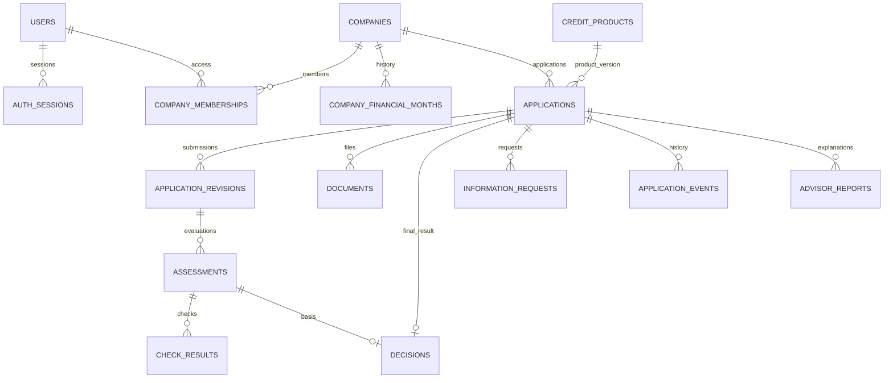

# База данных: спецификация для demo-0.2

Статус: согласованная схема MVP, синхронизированная с [SYNTETIC.md](SYNTETIC.md), schema_version=2 / demo-policy-0.2. Набор и продукт: demo-0.2 / WC_DEMO/version=2. schema_version — версия предметного контракта, не миграция Alembic. Начало реализации разрешено; модели и миграции создаются отдельной веткой backend. Общая архитектура: [ARCHITECTURE.md](ARCHITECTURE.md). Интерфейсы и жизненный цикл: [USER_FLOWS.md](USER_FLOWS.md).

## 1. Границы и принципы

Одна PostgreSQL обслуживает клиентский и банковский контуры. Права задает backend: отдельная страница банка не дает доступа сама по себе. В MVP две роли: CLIENT и BANK_STAFF. Административного интерфейса нет; исходные учетные записи создает подготовка демо.

Проект включает 15 небольших таблиц, но реализуется по этапам. Не нужны отдельные базы для AI, сессий или каждой роли. Разделение таблиц сохраняет смысл данных и историю, а не делает каждый модуль отдельным сервисом.

Ключевые различия:

- Профиль компании — исходные сведения для предзаполнения. Черновик заявки — то, что клиент сейчас редактирует.
- Отправленная версия — неизменяемый снимок. Банковские проверки относятся к нему, а не к текущему черновику.
- Запуск оценки содержит результаты проверок и риск. Итоговое решение — отдельная запись.
- AI-разбор и расчет альтернатив не являются решением банка.
- Версия редактирования lock_version, номер отправки revision_no и номер повторной оценки run_no — разные счетчики.

## 2. Общие типы и соглашения

У каждой таблицы есть id типа UUID и created_at типа TIMESTAMPTZ. Они не повторяются в каждом перечне. updated_at добавляется к изменяемым записям. Знак `?` ниже означает nullable.

| Данные | Хранение и контракт |
| --- | --- |
| Ссылки | UUID + внешние ключи; UUID не заменяет проверку доступа |
| Деньги | NUMERIC(18,2), RUB; в API десятичные строки, в Python Decimal |
| Годовая ставка | NUMERIC(6,3), проценты годовых: 24.000 означает 24%, не 0.24 |
| Доли и отношения | NUMERIC с явно заданной точностью; единицы описаны рядом с показателем |
| Время | TIMESTAMPTZ, запись/обмен в UTC; интерфейс форматирует для пользователя |
| Месяц | DATE, первое число месяца |
| ИНН/ОГРН/ОКВЭД | Строки, не числа; демонстрационные значения не используются во внешних запросах |
| Статусы | Ограниченный набор значений, проверяемый API и БД |
| JSONB | Снимки, факторы, компактные конфигурации; со схемой и версией, не произвольный JSON клиента |

NUMERIC предназначен для точных десятичных величин; float для денежных сумм не используем ([PostgreSQL](https://www.postgresql.org/docs/current/datatype-numeric.html)). Пустое значение отличается от нуля. NaN, Infinity и некорректные периоды отклоняются до сохранения. Время входа/сессии всегда реальное; демонстрационная дата финансового расчета не влияет на истечение сессии.

## 3. Учетные записи и доступ

### 3.1. users

| Поле | Тип / смысл |
| --- | --- |
| email | TEXT, нормализованное уникальное значение; используется как логин |
| password_hash | TEXT, результат Argon2id готовой библиотеки, не исходный пароль |
| display_name | TEXT, имя для интерфейса |
| role | CLIENT / BANK_STAFF |
| is_active | BOOLEAN, возможность входа |
| ui_context | JSONB, только разрешенные ключи: последняя заявка и раздел; без произвольного redirect URL |
| updated_at | TIMESTAMPTZ |

ui_context — удобство восстановления, а не разрешение на доступ. Любой идентификатор из него повторно проверяется сервером. Клиент не может менять role или is_active через обновление профиля.

### 3.2. auth_sessions

| Поле | Тип / смысл |
| --- | --- |
| user_id | UUID → users |
| token_hash | TEXT, уникальный SHA-256 случайного высокоэнтропийного токена; исходный session token в БД не хранится |
| csrf_token | TEXT, отдельный защитный токен сессии; передается только разрешенному frontend, не логируется |
| last_activity_at | TIMESTAMPTZ, пользовательская активность, без фонового polling |
| absolute_expires_at | TIMESTAMPTZ, окончательный предел жизни |
| idle_expires_at | TIMESTAMPTZ, предел неактивности |
| revoked_at | TIMESTAMPTZ?, выход или принудительный отзыв |

Пароль и случайный session token хешируются разными способами. Cookie содержит исходный session token, а не user_id и не пароль. CSRF-токен не заменяет авторизацию. Предварительная защита входа использует отдельный короткоживущий защитный контекст; не создаем ради него пользователя или бизнес-заявку. Политика срока и cookie описана в [IMPLEMENTATION_PLAN.md](IMPLEMENTATION_PLAN.md).

### 3.3. companies

| Поле | Тип / смысл |
| --- | --- |
| legal_name | TEXT, вымышленное название |
| legal_form | IP / OOO, ограничение демонстрационного MVP |
| inn | TEXT, уникальный демонстрационный идентификатор |
| registration_number | TEXT?, демонстрационный ОГРН/ОГРНИП |
| registered_on | DATE, дата регистрации |
| okved_code | TEXT, основной вид деятельности |
| region_code | TEXT |
| business_description | TEXT? |
| updated_at | TIMESTAMPTZ |

### 3.4. company_memberships

| Поле | Тип / смысл |
| --- | --- |
| user_id | UUID → users |
| company_id | UUID → companies |
| updated_at | TIMESTAMPTZ |

Пара user_id/company_id уникальна. В первой версии все участники компании имеют одинаковые клиентские права. Если понадобятся подписант/бухгалтер/наблюдатель, это отдельное расширение. BANK_STAFF не нужно добавлять участником всех компаний: его доступ идет через отправленные банковские обращения.

## 4. Исходные финансы и продукт

### 4.1. company_financial_months

| Поле | Тип / смысл |
| --- | --- |
| company_id | UUID → companies |
| month | DATE, уникален внутри компании |
| cash_inflow | NUMERIC(18,2), фактические операционные поступления; без кредитов, взносов собственника и внутренних переводов |
| operating_outflow | NUMERIC(18,2), реальные операционные выплаты и моделируемые налоги; без внутренних переводов и платежей по долгам |
| existing_debt_payment | NUMERIC(18,2), тело и проценты платежей по действующим обязательствам за месяц; не остаток основного долга |
| source | DEMO / DECLARED, источник профиля |
| updated_at | TIMESTAMPTZ |

В MVP рассматриваем денежный поток, а не подменяем его бухгалтерской прибылью. Поток до обслуживания долга рассчитывается как cash_inflow минус operating_outflow. Отрицательный поток допустим; сами три суммы неотрицательны. Отсутствующий месяц не превращаем в нулевой. Обязательства из БКИ сопоставляются с заявленными, не складываются повторно как независимые долги.

НДС учитывается в составе фактических денежных операций там, где присутствует; отдельный расчет начислений/вычетов не добавляется поверх сумм. Финансовое окно — апрель–сентябрь 2026 года, дата расчета 2026-10-01. Нулевые значения не заменяют пропуски.

Профиль предзаполняет заявку. Исправление финансов в одной заявке меняет ее draft_data, а не автоматически все заявки и общий профиль компании.

### 4.2. credit_products

| Поле | Тип / смысл |
| --- | --- |
| code / version | TEXT / INTEGER, уникальная пара; версия конфигурации неизменяема |
| name / description | TEXT, название и описание |
| allowed_purposes | JSONB, разрешенные коды целей |
| min_amount / max_amount | NUMERIC(18,2), положительный допустимый диапазон |
| min_term_months / max_term_months | INTEGER, положительный диапазон срока |
| annual_rate_percent | NUMERIC(6,3), вымышленная фиксированная ставка продукта |
| policy_version | TEXT, идентификатор демонстрационных правил |
| policy_config | JSONB, пороги и параметры с определенной схемой |
| is_active | BOOLEAN, доступность для новых обращений |

Для текущего контракта WC_DEMO/version=2: RUB, 100000.00–5000000.00, 6–24 целых месяца, 24.000% годовых, demo-policy-0.2. Версия 2 фиксирует новые юридические/подтверждающие условия; арифметика и балльные пороги не изменились.

В MVP один продукт — оборотный кредит. Изменение условий создает новую версию, не переписывает старую. При отправке backend проверяет актуальность предложения; если нужна новая версия, клиенту явно предлагается пересчет. Старые отправки не меняются из-за новых условий.

## 5. Заявка и неизменяемые отправки

### 5.1. applications

| Поле | Тип / смысл |
| --- | --- |
| company_id | UUID → companies |
| created_by_user_id | UUID → users |
| product_id | UUID → credit_products, конкретная версия |
| status | DRAFT / SUBMITTED / CHECKING / NEEDS_INFO / MANUAL_REVIEW / APPROVED / REJECTED |
| requested_amount | NUMERIC(18,2)?, сумма черновика |
| term_months | INTEGER?, срок черновика |
| purpose_code / purpose_details | TEXT? / TEXT?, цель и пояснение |
| draft_data | JSONB, ответы, financial_months, confirmations.data_confirmed и confirmations.credit_history_check_allowed, ссылки на документы и ответ на дозапрос |
| ui_step | TEXT, код шага формы из разрешенного списка |
| lock_version | INTEGER, версия для защиты от параллельного изменения |
| calculation_date | DATE, дата, на которую рассчитаны демонстрационные финансовые признаки |
| submitted_at | TIMESTAMPTZ?, время первой отправки |
| closed_at | TIMESTAMPTZ?, итоговый результат |
| updated_at | TIMESTAMPTZ |

Черновик может быть неполным. Перед отправкой обязательны базовые параметры и валидные типы; недостаток дополнительных сведений может быть основанием дозапроса. Не создаем отдельную таблицу черновиков. До финала requested_amount и другие рабочие поля могут меняться только в разрешенном статусе. Банк читает отправленный снимок, не эти редактируемые поля.

Перед submit проверяются оба confirmations=true; отсутствие подтверждения БКИ — 422, не новая отправка/оценка/кредитный отказ. Клиент не может записать юридический is_bankrupt или назначить provenance=MOCK_BKI. Предпросмотр без подтверждения ограничен платежом/переплатой и не обращается к источникам. /advisor до подтверждения также возвращает 422, не вызывает LLM.

### 5.2. application_revisions

| Поле | Тип / смысл |
| --- | --- |
| application_id | UUID → applications |
| revision_no | INTEGER, 1, 2, 3…; уникален внутри заявки |
| submitted_by_user_id | UUID → users |
| source_lock_version | INTEGER, какая версия черновика отправлена |
| submission_key | UUID, ключ повторяемой отправки; уникален внутри заявки |
| input_hash | TEXT, хеш канонического набора входов для проверки повторов |
| requested_amount / term_months / purpose_code | NUMERIC(18,2) / INTEGER / TEXT, отправленные параметры |
| company_snapshot | JSONB, реквизиты и provenance на момент отправки |
| financial_snapshot | JSONB, месяцы, обязательства, ответы клиента, confirmations и provenance на момент отправки |
| product_snapshot | JSONB, условия и policy_config конкретной версии |
| document_refs | JSONB, идентификаторы и контрольные суммы документов |
| schema_version | INTEGER, версия структуры снимков |

Оба подтверждения находятся в financial_snapshot.confirmations; автор — submitted_by_user_id, серверное время фиксации — created_at отправки. Не добавляем таблицу согласий или дублирующие поля времени. Это моделирование проверки, не юридическая подпись.

Предварительный расчет использует подтверждение текущего черновика; официальная обработка/банковский повтор использует подтверждение сохраненной отправки. Создание черновика не проставляет согласия автоматически. Это сохраняет неизменяемость входов при клиентских правках.

created_at у этой таблицы — время отправки. Содержимое версии не редактируется. Текущая отправка определяется максимальным revision_no; дополнительную циклическую ссылку из applications в revisions пока не вводим.

Отправка под блокировкой заявки атомарно создает версию, меняет статус и пишет событие. Одинаковый submission_key с одинаковыми входами возвращает существующий результат; с другими входами — конфликт. Дозапрос приводит к новой отправке, а не редактированию старого снимка. ui_step и счетчик lock_version не входят в содержательный хеш финансовой заявки.

### 5.3. documents

| Поле | Тип / смысл |
| --- | --- |
| application_id | UUID → applications |
| created_by_user_id | UUID? → users; null для подготовки демо |
| kind | TEXT, известный тип документа |
| original_filename / mime_type | TEXT / TEXT |
| storage_key | TEXT, внутренний ключ неизменяемого файла |
| content_sha256 | TEXT, контрольная сумма |
| size_bytes | BIGINT, неотрицательный размер |
| source | DEMO / UPLOAD; UPLOAD только при добавлении загрузок |

В БД метаданные, сами файлы в поставке/томе. Для MVP создаем записи подготовленных синтетических документов. Снимок перечисляет именно те document id, которые отправлены; документ другой заявки прикрепить нельзя. Исправленный файл получает новую запись и ключ, старый не перезаписывается. Банк может скачать только документ, включенный в разрешенную отправленную версию, не будущий файл черновика.

## 6. Проверки, риск, решения и дозапрос

### 6.1. assessments

| Поле | Тип / смысл |
| --- | --- |
| revision_id | UUID → application_revisions |
| run_no | INTEGER, уникален внутри отправленной версии |
| rules_version | TEXT, версия алгоритма и политики |
| input_facts | JSONB, вычисленные признаки, единицы и provenance использованных групп фактов |
| risk_score | INTEGER?, балл демонстрационного риска, не PD |
| risk_band | LOW / MEDIUM / HIGH / UNKNOWN |
| routing | APPROVE / REJECT / NEEDS_INFO / MANUAL_REVIEW |
| reason_codes | JSONB, коды объясняющих факторов |
| calculation_details | JSONB, платеж, поток, отношения и примененные правила |
| started_at / completed_at | TIMESTAMPTZ / TIMESTAMPTZ |

Запись — завершенный запуск оценки. При повторной технической проверке создается новый run_no; старый запуск не переписывается. routing — рекомендация маршрута, а не финальное решение. После ошибки обязательного источника риск может быть UNKNOWN; отсутствие ответа не считаем плохой кредитной историей.

### 6.2. check_results

| Поле | Тип / смысл |
| --- | --- |
| assessment_id | UUID → assessments, через него определяется отправленная версия |
| source | DATA_QUALITY / FNS / BKI, уникален внутри одного запуска |
| status | SUCCESS / NO_DATA / ERROR |
| normalized_data | JSONB?, минимальные сохраненные результаты проверки |
| reason_codes | JSONB, смысловые признаки результата |
| error_code | TEXT?, технический код без stack trace |
| source_version | TEXT, версия симулятора/контракта |
| started_at / completed_at | TIMESTAMPTZ / TIMESTAMPTZ |

SUCCESS означает, что ответ получен корректно, а не что компания надежна: полученный ответ может содержать негативные факторы. Для повторов хранится новый assessments + check_results. Отдельная таблица всех кредитов из БКИ для MVP не нужна: достаточные нормализованные сведения находятся здесь и в input_facts.

Юридический нормализованный ответ текущего слота FNS содержит is_bankrupt=true/false/null. Это консолидированный демо-адаптер legal-mock-0.2, не обещание настоящего интерфейса ФНС. true дает COMPANY_BANKRUPTCY/REJECTED, неизвестное значение — LEGAL_STATUS_UNCONFIRMED/MANUAL_REVIEW. Поле не находится в companies и не вводится клиентом. Для восьми базовых компаний false; true/null проверяются отдельными сценариями.

provenance хранится в существующих JSONB снимков, input_facts и контекста AI; новые столбцы и таблицы не нужны. Для успешной проверки normalized_data содержит вложенный ключ provenance, перенесенный из fixture-envelope. При ERROR/NO_DATA normalized_data остается null; источник/время попытки и контекст дат восстанавливаются из source, source_version, completed_at и отправленного снимка. Отсутствие фактов не обозначается как проверенное отсутствие риска.

### 6.3. decisions

| Поле | Тип / смысл |
| --- | --- |
| application_id | UUID → applications, уникален: один финальный результат на заявку |
| revision_id | UUID → application_revisions, последняя отправка |
| assessment_id | UUID → assessments, актуальная оценка этой отправки |
| source | AUTO / MANUAL |
| decided_by_user_id | UUID? → users; null для автоматического решения |
| outcome | APPROVED / REJECTED |
| approved_amount / approved_term_months | NUMERIC(18,2)? / INTEGER? |
| annual_rate_percent / monthly_payment | NUMERIC(6,3)? / NUMERIC(18,2)? |
| reason_codes / public_explanation | JSONB / TEXT, клиентские причины |
| internal_comment | TEXT?, комментарий сотрудника только для банка |
| policy_version | TEXT, зафиксированные правила |

Одобренные условия обязательны при APPROVED; при REJECTED не создаем фиктивное предложение. В MVP сотрудник подтверждает параметры рассматриваемой версии, не назначает произвольные ставку и сумму. Другие параметры клиент выбирает через новый расчет/черновик. Ручное решение требует причины; одобрение не может обойти отсутствующую обязательную проверку или жесткое ограничение продукта.

Ссылки application/revision/assessment должны относиться друг к другу. Backend проверяет это при действии; для реализации предусматриваем составные FK там, где дублируемые идентификаторы позволяют поставить такие ограничения. Финальный status, decision и событие записываются в одной транзакции. Итоговый результат не меняется кнопкой «редактировать».

### 6.4. information_requests

| Поле | Тип / смысл |
| --- | --- |
| application_id | UUID → applications |
| revision_id | UUID → application_revisions, по какой отправке задан вопрос |
| created_by_user_id | UUID? → users; null для автоматического дозапроса |
| requested_fields | JSONB, разрешенные коды требуемых сведений |
| message_to_client | TEXT, понятный вопрос/инструкция |
| status | OPEN / ANSWERED |
| answer_text | TEXT?, ответ, зафиксированный при повторной отправке |
| answered_revision_id | UUID? → application_revisions, новая отправка той же заявки |
| answered_at | TIMESTAMPTZ? |

В MVP один открытый дозапрос на заявку. Пока клиент печатает ответ, он остается в draft_data. Дозапрос закрывается атомарно с новой отправкой и указывает на нее. Полученный ответ еще не является одобрением. После финального решения новый дозапрос не создается.

## 7. История и AI

### 7.1. application_events

| Поле | Тип / смысл |
| --- | --- |
| application_id | UUID → applications |
| revision_id | UUID? → application_revisions |
| sequence_no | INTEGER, уникален внутри заявки, стабильный порядок |
| actor_user_id | UUID? → users; null для системного действия |
| event_type | DRAFT_CREATED / SUBMITTED / CHECKS_COMPLETED / INFO_REQUESTED / INFO_ANSWERED / DECISION_MADE / PROCESSING_RETRIED и согласованные расширения |
| from_status / to_status | TEXT? / TEXT?, если был переход |
| visibility | CLIENT / BANK |
| message | TEXT, подходящее для этой аудитории описание |
| details | JSONB, минимальный контекст без секретов |

Бизнес-история дописывается, не редактируется через пользовательский API. Это не полное event sourcing: актуальный статус хранится в applications. Не пишем отдельное событие на каждый символ автосохранения. Клиент получает только CLIENT-события; публичная запись не содержит внутренних комментариев. Эта история не заявляется как промышленный tamper-proof аудит.

### 7.2. advisor_reports

| Поле | Тип / смысл |
| --- | --- |
| application_id | UUID → applications, включая черновик до первой отправки |
| revision_id | UUID? → application_revisions, если объясняем отправленную версию |
| created_by_user_id | UUID → users |
| draft_lock_version | INTEGER?, версия черновика во время запроса |
| input_hash | TEXT, хеш фактов/параметров/правил, влияющих на отчет |
| context_snapshot | JSONB, разрешенные факты, дата, версия правил и идентификатор оценки при наличии |
| scenarios | JSONB, рассчитанные backend альтернативы и показатели |
| explanation | JSONB?, проверенный структурированный ответ |
| status | SUCCESS / FALLBACK / FAILED |
| model_id / model_digest / prompt_version | TEXT? / TEXT? / TEXT |
| generation_config | JSONB, ограничения контекста/ответа и параметры воспроизведения |
| latency_ms / error_code | INTEGER? / TEXT? |

При нажатии «Подобрать финансирование» создается application в DRAFT: поэтому AI уже до отправки имеет application_id. Чат общего назначения и таблица chat_messages в MVP не нужны. В свободном тексте можно ограниченно описать потребность; расчет и основные параметры остаются структурированными.

Изменение финансов, параметров, правил или используемой оценки делает старый отчет неактуальным. Одно изменение шага формы не обязано инвалидировать его: актуальность определяется input_hash. Статус устаревания можно вычислять при чтении, не переписывая старый отчет.

Сначала читаем разрешенный контекст, завершаем транзакцию, вызываем модель с таймаутом, затем сохраняем результат короткой транзакцией. Во время генерации не держим блокировку заявки. Если входы изменились, старый ответ не показывается как текущий. Ни текст модели, ни выбор гипотезы сами по себе не создают decisions.

### 7.3. Контракт provenance и допустимые различия source

Единый provenance в JSONB/API имеет группы company, financial_months, credit_history. Группа — null или объект source/as_of_date/checked_at. source: DEMO_PROFILE, CLIENT_DECLARED, MOCK_FNS, MOCK_BKI. as_of_date — дата данных (финансы 2026-09-30, юридическая/кредитная проверка 2026-10-01); checked_at — реальное время завершения вызова или null.

Не меняем перечисления существующих колонок: company_financial_months.source остается DEMO/DECLARED, отображается как DEMO_PROFILE/CLIENT_DECLARED; check_results.source остается DATA_QUALITY/FNS/BKI. Четыре новых значения относятся к вложенному происхождению, не к этим колонкам. Изменение финансового блока пользователем снимает исходную отметку профиля и ставит CLIENT_DECLARED на уровне JSONB/API.

Снимки фиксируют происхождение на момент отправки. Более поздняя проверка дописывается в check_results/assessment, не меняет старый company_snapshot. Без подтверждения БКИ API/AI не получают credit_history даже из кэша; группа null. input_hash учитывает подтверждение, факты, source/as_of_date и правила; только обновление checked_at не меняет финансовый результат.

Стресс-сценарий остается перспективой после хакатона: таблиц, полей, моделей и расчетной ветки под него сейчас нет.

## 8. Связи

Диаграмма показывает основные связи, не каждый FK. Ссылки на автора, отправленную версию дозапроса и документы в снимках описаны выше.

## 9. Ограничения и индексы

- UNIQUE: users.email, sessions.token_hash, membership(user,company), financial_month(company,month), product(code,version), revision(application,revision_no), revision(application,submission_key), assessment(revision,run_no), check(assessment,source), decision.application_id, event(application,sequence_no).
- FK на владельцев и связанные записи; не удаляем компанию/пользователя каскадно вместе с кредитной историей. Для MVP учетную запись отключаем через is_active, бизнес-записи не удаляем через UI.
- CHECK: положительные суммы запроса и сроки, допустимые статусы, согласованные диапазоны продукта, неотрицательные исходные финансовые суммы. Дополнительные межтабличные условия проверяются в транзакции.
- Индексы: заявки по company_id/updated_at, банковская очередь по status/submitted_at, версии по application_id/revision_no, сессии по user_id/сроку, оценки по revision_id/run_no, история по application_id/sequence_no, AI-отчеты по application_id/input_hash/created_at. Индексы FK добавляем по реальным обращениям, не считаем их автоматическими.
- PATCH использует lock_version; отправка и банковское решение блокируют заявку на короткое время. Старый запрос получает конфликт, не перезаписывает новый результат. Уникальные ограничения остаются последним барьером от дублей ([PostgreSQL constraints](https://www.postgresql.org/docs/current/ddl-constraints.html), [SQLAlchemy versioning](https://docs.sqlalchemy.org/en/20/orm/versioning.html)).

Версионирование SQLAlchemy не заменяет дисциплину всех способов записи: массовые UPDATE не должны обходить проверку версии. Обновления выполняем через единый слой действий.

## 10. Что хранится за весь цикл и где

| Момент | Записи |
| --- | --- |
| Подготовка демо | users, companies, memberships, financial_months, products; файлы синтетических документов вне БД |
| Вход | auth_sessions; пароль остается только в password_hash |
| Начало подбора | applications(DRAFT), связанные demo documents, событие создания |
| Работа с формой | Обновляется черновик/lock_version/ui_step, при необходимости ui_context |
| AI и сравнение | advisor_reports с контекстом, расчетами и происхождением объяснения |
| Отправка | После проверки обоих подтверждений — неизменяемая application_revision с confirmations/provenance, SUBMITTED и событие |
| Проверки | assessments + check_results с is_bankrupt/provenance; затем маршрут и события |
| Дозапрос | information_request(OPEN), NEEDS_INFO, клиентское событие |
| Ответ | Новый revision, request(ANSWERED), новая оценка, старые записи сохраняются |
| Ручное/автоматическое решение | decisions, APPROVED/REJECTED, closed_at, событие |
| Повторная обработка после сбоя | Тот же revision, новый assessment run, история повтора |
| Выход/истечение | Отзыв или истечение auth_session; заявка, отчеты и история не удаляются |

В БД не храним исходные пароли, исходные session tokens, веса модели и бинарные документы. Веса и файлы живут в поставке/volumes; технические логи идут в stdout. Демо-ожидания вида «этот сценарий должен отказать» живут в тестовых fixtures, не становятся полем команды для принятия решения. Кредитных счетов, транзакций выдачи, SMS и юридически значимых подписей в этом MVP нет.

## 11. В какой последовательности реализовывать схему

1. Доступ и первый черновик: users, auth_sessions, companies, company_memberships, credit_products, applications. Результат — вошел, создал, сохранил, открыл снова.
2. Данные и первый результат: company_financial_months, documents, application_revisions, assessments, check_results, decisions, application_events. Результат — первый сквозной путь с историей и снимком входов.
3. Банковское исключение: information_requests и разрешенные действия. Результат — дозапрос/ручное решение и новая отправка без потери истории.
4. AI: advisor_reports. Результат — объяснение и сценарии на разрешенных данных заявки, актуальность и fallback.

Поля и терминология закреплены в demo-0.2. Миграции добавляются в migrations/; исходники моделей — в src/credit_cabinet/models/. Новая предметная схема не требует дополнительных таблиц: в целевой модели остаются 15.
