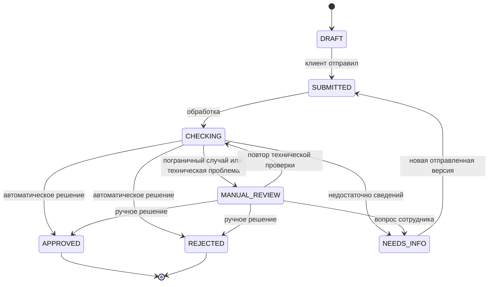

# Два контура, экраны и жизненный цикл

Статус: согласованная продуктовая схема demo-0.2; backend уже поддерживает вход, компании, продукт и сохраняемые черновики; React/TypeScript/Vite реализуется отдельно. Остальные описанные ниже сценарии остаются целевой схемой. Действующий контракт полей/причин/данных — [SYNTETIC.md](SYNTETIC.md). AI-помощь остается в той же форме: объяснение и сравнение суммы/срока, без стресс-сценария. Поля и связи БД: [DATABASE.md](DATABASE.md). Компоненты: [ARCHITECTURE.md](ARCHITECTURE.md).

## 1. Два контура одного приложения

Клиентский и банковский контуры используют общий backend и базу, но разные представления данных и разрешенные действия. Браузер не подключается к PostgreSQL напрямую. У сотрудников отдельные подготовленные учетные записи; клиент не может стать сотрудником, открыв /bank.

| Возможность | Клиент | BANK_STAFF в демонстрационном MVP |
| --- | --- | --- |
| Компания | Компании, где есть membership | Сведения в контексте отправленных заявок |
| Неотправленный черновик | Свой, с правом редактирования | Не видит |
| Отправленная заявка | Свои разрешенные компании | Все отправленные обращения демонстрационного банка |
| Правки после дозапроса | Редактирует draft | До повторной отправки видит прежний снимок |
| Проверки | Понятный итог и следующий шаг | Результаты источников, ошибки, факторы риска |
| Решение | Читает итоговые условия/причины | Принимает допустимое ручное решение |
| Внутренние комментарии | Не получает через API | Видит и добавляет в рамках действий |
| AI | Подбор и объяснение своих параметров | Может видеть отчет по отправленному снимку; не читает чужой клиентский черновик |

Все отправленные обращения доступны сотрудникам только как упрощение MVP; реальный банк потребует подразделений, назначения исполнителя и дополнительных ограничений. Права проверяются backend при каждом действии, включая документы и AI; различий меню недостаточно ([OWASP Authorization](https://cheatsheetseries.owasp.org/cheatsheets/Authorization_Cheat_Sheet.html)).

## 2. Клиентский интерфейс

Навигация: «Обзор», «Мои заявки», «Компания». Ассистент встроен в подбор, не отдельный обязательный маршрут.

| Экран | Содержимое и кнопки |
| --- | --- |
| Вход | Логин, пароль, «Войти», понятная ошибка |
| Обзор | Компания, текущие заявки, «Подобрать финансирование», «Продолжить заявку» при наличии черновика |
| Мои заявки | Сумма, срок, статус, последнее событие, «Открыть» |
| Компания | Демонстрационный профиль и исходные показатели; сложное редактирование профиля в MVP не требуется |
| Подбор/черновик | Цель, сумма, срок, сведения компании, операционные поступления/выплаты, платежи по долгам, источники и автосохранение |
| AI-блок в подборе | «Помочь подобрать», «Объяснить расчет», «Сравнить варианты», «Каких данных не хватает?»; доступность зависит от полноты входов |
| REVIEW | Итог, подготовленные документы, отдельные подтверждения data_confirmed и credit_history_check_allowed, отправка |
| Карточка заявки | Отправленные параметры/подтверждения, история, статус, решение; при дозапросе «Дополнить сведения» |

Первый продукт — оборотный кредит. Основной сценарий: потребность → параметры → сведения о бизнесе/финансы → проверка введенного → отправка. Это не витрина произвольных кредитов и ставок. На каждом шаге сохраняется прогресс; для пропуска обязательных сведений нет скрытого клиентского «одобрения».

Нажатие «Подобрать финансирование» создает черновик. Пользователь может вводить параметры вручную либо пользоваться AI-кнопками; оба пути меняют одну форму. Backend считает варианты, модель объясняет. Кнопка «Выбрать эти параметры» явно переносит расчет в черновик; «Отправить заявку» — отдельное действие.

Демо-подтверждение БКИ связано с draft_data.confirmations.credit_history_check_allowed. Тот же checkbox доступен рядом с ранней AI-помощью и в REVIEW. До true можно получить платеж/переплату, но не load_ratio, risk_score или предварительный маршрут: они null. БКИ и другие симуляторы для этого ограниченного расчета не вызываются. /advisor и отправка без подтверждения возвращают 422 с подсказкой; LLM/отчет не запускаются. Поле data_confirmed отдельно требуется при отправке.

provenance подписывает группы «Демонстрационный профиль», «Указано пользователем», «Юридический демо-симулятор», «Демо-симулятор кредитной истории». Показываем дату данных и время проверки без смешения. Финансовая правка меняет источник на CLIENT_DECLARED; флаг БКИ и используемые факты влияют на актуальность отчета. is_bankrupt не вводится клиентом.

Неполный ввод не вызывает выдуманный расчет: показываем, чего не хватает. Предварительный вариант не называется одобрением. При смене входов старый AI-разбор обозначается как неактуальный. На потерю сессии UI отвечает повторным входом с восстановлением разрешенного контекста.

## 3. Рабочее место сотрудника банка

После входа сотрудник попадает в «Очередь заявок», а не на клиентский подбор. Навигация: «Очередь», «Решения»; последняя может быть фильтром общего списка.

В очереди: идентификатор, компания, продукт, запрошенные сумма/срок, дата отправки, статус и причина внимания. Фильтры: ручное рассмотрение, ожидание клиента, завершенные, техническая проблема. Персональное назначение исполнителя и отдельный supervisor в MVP не обязательны.

В карточке сотрудник видит:

1. Последнюю отправленную версию и номер отправки; возможность открыть предыдущую.
2. Сведения компании и помесячные показатели из снимка, не текущие неотправленные правки.
3. Юридический симулятор/БКИ: успешность ответа, is_bankrupt=true/false/null, отрицательные признаки или техническую ошибку; источник, дату данных и время проверки. MOCK — явная пометка имитации.
4. Балл/категорию риска, значения факторов, рассчитанный платеж, примененные продуктовые ограничения и версию правил.
5. Причину направления сотруднику, открытый дозапрос, прошлые ответы и историю.
6. Доступные отправленные документы.
7. Итоговое решение и внутренний комментарий при наличии. AI-объяснение по этому снимку — вспомогательная вкладка при готовности, не отдельный второй AI-продукт.

| Кнопка | Когда доступна и что делает |
| --- | --- |
| Запросить уточнение | В MANUAL_REVIEW; создает вопрос/перечень полей и NEEDS_INFO |
| Одобрить | В MANUAL_REVIEW по BORDERLINE_RISK, если обязательные проверки успешны, is_bankrupt=false и параметры разрешены продуктом; нужны причина/комментарий |
| Отказать | В MANUAL_REVIEW по BORDERLINE_RISK с содержательной причиной; неизвестный юридический факт/техническая ошибка сами по себе не отказ |
| Повторить обработку | Для прерванной SUBMITTED, технической ошибки или LEGAL_STATUS_UNCONFIRMED после уточнения fixture; новый run_no той же отправки |
| История / предыдущая версия | Чтение сохраненных снимков и событий |

Кнопки меняют бизнес-процесс, а не произвольный status. Сотрудник не редактирует финансовые сведения за клиента и не назначает произвольную ставку. В APPROVED/REJECTED кнопок нового решения нет. Если два сотрудника действуют одновременно, второй получает конфликт и актуальное состояние.

is_bankrupt=true дает финальный REJECTED/COMPANY_BANKRUPTCY; неизвестное значение — MANUAL_REVIEW/LEGAL_STATUS_UNCONFIRMED, без подстановки false и без кнопки обхода. Для всех восьми нормальных профилей false, их баллы прежние.

## 4. Жизненный цикл приложения

Запуск: PostgreSQL готов → init применяет миграции и добавляет отсутствующие demo-записи → API становится готовым → web обслуживает пользователей. Полный AI-профиль отдельно поднимает модель и подготавливает веса; основное приложение способно явно сообщить об ее недоступности и продолжить процесс без AI.

Вход: backend проверяет пароль → создает серверную сессию → cookie сохраняется в браузере → frontend узнает роль через /auth/me и открывает нужный контур. Перезапуск API при сохранной базе не очищает сессии. Просроченная сессия требует входа, но не удаляет заявку.

Работа: frontend выполняет действия → backend проверяет сессию, роль, компанию, версию и статус → сохраняет изменения транзакционно → возвращает актуальные данные и allowed_actions. При нормальной остановке данные остаются в volumes; миграции/seed при следующем старте не сбрасывают прогресс.

## 5. Жизненный цикл заявки

CHECKING в коротком локальном MVP может быть внутренним этапом одной транзакции: UI не обязан успеть увидеть его на экране. Не делаем искусственные задержки. Если процесс прервался до сохранения результата, транзакция обработки откатывается, а сохраненная отправка остается доступна для повторной обработки.

Перед каждой новой отправкой проверяются оба confirmations=true, затем они сохраняются в financial_snapshot. Отсутствие отметки — 422 без новой версии/БКИ/отказа. Снимок фиксирует источник на момент отправки; более поздняя проверка не переписывает его, а создает результат оценки.

Пример: черновик → версия 1 → проверки → ручное рассмотрение → вопрос сотрудника → клиент правит черновик → версия 2 → новые проверки → решение. Версия 1, первый запуск и дозапрос сохраняются. Решение ссылается на версию 2 и ее оценку. Банк до отправки версии 2 не получает неготовые правки.

## 6. Первый результат для Сергея

Пока без кода: передать команде согласованные [SYNTETIC.md](SYNTETIC.md) demo-0.2 и [DATABASE.md](DATABASE.md). Поля, ошибки и пороги уже зафиксированы; Валера/София используют восемь профилей и новые сценарии, Ксюша — форму/источники/подтверждения, Дима — manifest и запуск. Банковской достоверности вымышленных порогов не заявляем.

После отдельного начала реализации первый этап: каркас FastAPI + конфигурация → PostgreSQL/Alembic с Димой → демо-пользователь/компания/продукт → вход/сессия/me/logout → создание/чтение/PATCH черновика и контроль версии.

Критерий первого этапа: вошел, создал заявку, сохранил сумму и шаг, закрыл вкладку, вернулся, увидел те же данные; после перезапуска API результат сохраняется, другой пользователь его не получает. Это первый рабочий кусок, на который Ксюша подключает интерфейс. Только затем — отправка, проверки, банковские действия и AI.

Вне текущей реализации: стресс-сценарий и дополнительные AI-функции, полный KYC, паспортные загрузки, выдача/подпись, календарный график и автоистечение заявки. Стресс-идея остается только перспективой после хакатона, не скрытым следующим этапом текущего плана.
